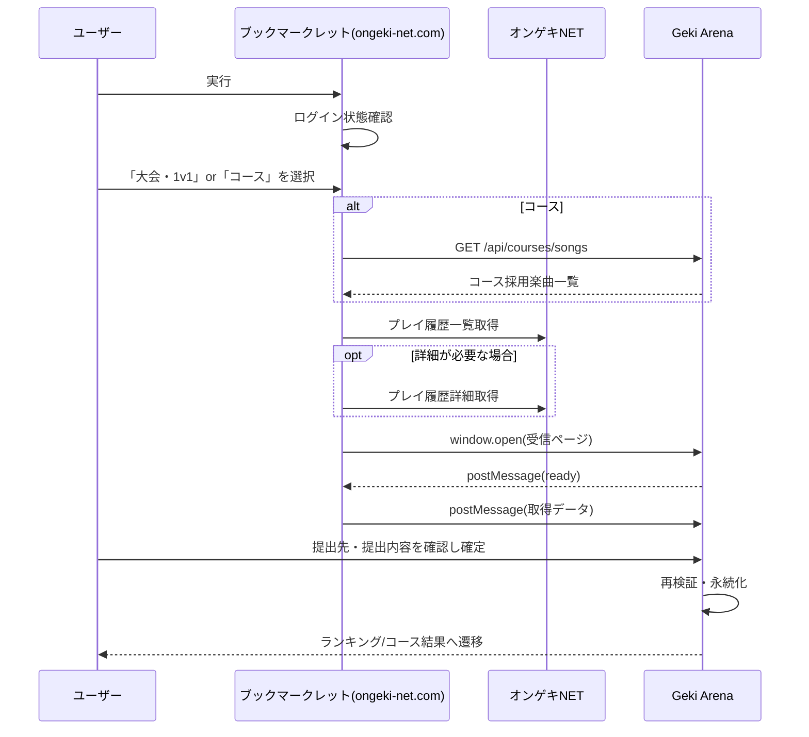

# Bookmarklet Score Submission

## Overview
- ブックマークレットによるスコア提出の技術設計を定義する。要件は`requirements/score.md`、オンゲキNETの構造は`ongeki-net.md`を参照。

## Components
- ブックマークレットスクリプト: オンゲキNET上で実行し、プレイ履歴を取得して当システムへ渡す。当システムが生成・提供する。
- 受信ページ（`/score-submissions/receive`）: ブックマークレットが開くページ。データを受信し、提出確認画面として機能する。ログイン済みセッションで動作する（Client Component）。
- 提出処理（Server Action）: 確認内容の確定時にサーバー側で再検証し、永続化する。
- コース楽曲API（`GET /api/courses/songs`）: コースに採用されている全楽曲を返す。

## Flow

## Login Check
- ブックマークレットは`https://ongeki-net.com/ongeki-mobile/`配下で実行されていることを確認する。それ以外の場合は案内を表示して終了する。
- 現在のページがログインページ（`/ongeki-mobile/`）またはAime選択ページ（`/ongeki-mobile/aimeList/`）の場合は未ログインとみなし、ログインを促して終了する。
- プレイ履歴一覧の取得結果に履歴要素が存在しない（ログインページへ遷移した等）場合も未ログインとして扱う。

## Data Retrieval
### 大会・1v1
- プレイ履歴一覧（最大50件）の情報のみを取得する。譜面の判別に詳細ページは不要。

### コース
1. 「コース」選択直後に、`GET /api/courses/songs`で「コースに採用されている全楽曲（楽曲名・難易度・必要な譜面判別情報）」を取得する。
2. プレイ履歴一覧を取得し、1.の楽曲に該当しない履歴は詳細ページを取得しない。
3. 該当する履歴のみ詳細ページを取得し、詳細属性を付与する。
- 詳細ページ取得は、オンゲキNETへの負荷を抑えるため、同時実行数を制限した上で行う（上限は2）。

### Normalization
- 取得値はそのまま送信用の型に変換する（カンマ除去、日時のISO 8601化、難易度の`DifficultyType`化、Singularityの楽曲名置換）。
- Singularityはジャケット画像URLから`Singularity - xx`形式の楽曲名に置換する。
- ジャケット画像URLはそのまま送信する（Perfect Shining!! のレベル判別はサーバー側でこのURLを用いて行う）。

## Data Transfer
- ブックマークレットは`window.open`で受信ページを開き、受信ページからの`postMessage`（準備完了通知）を受けてから、取得データを`postMessage`で送信する。
- データはURLやクエリには含めない。
- 受信ページは`event.origin`が`https://ongeki-net.com`であることを検証し、それ以外のメッセージは無視する。ブックマークレット側も`targetOrigin`に当システムのオリジンを指定する。
- 受信ページが未ログインの場合はログインへ誘導する。ログイン後に受信したデータは保持できないため、ブックマークレットの再実行を促す。
- 送信データのスキーマ（`bookmarklet.v1`等のバージョン識別子を含める）は、オンゲキNET仕様変更時の互換性判断のため、バージョン番号を持たせる。

## Submission Confirmation Page
- 受信データから、ユーザーが提出先と内容を選択・確認する。
  - 大会・1v1: 提出先の大会または1v1を選択する。
  - コース: 提出先のコースを選択する。
- 提出候補は、提出先の種別に応じて下記の規則で自動的に決定し、ユーザーが確認する。

### Candidate Selection
- 対象期間: 大会・1v1は提出先の開催期間内に`playDateTime`があるプレイのみを候補とする。コースは期間の制約を設けない。
- 譜面の照合: 提出先の課題曲（譜面）に対し、楽曲名・難易度、および同一で複数の有効譜面がある場合はジャケット画像URLで照合する（`ongeki-net.md`のChart Matching参照）。照合できない履歴は候補としない。

#### 単曲提出（連続プレイ必須でない大会）
- 課題曲ごとに、期間内の最高テクニカルスコアのプレイを提出候補とする。
- ユーザーは、同一課題曲の他のプレイを任意に選択できる。

#### 連続プレイ（連続プレイ必須の大会・1v1・コース）
- 連続プレイとみなす条件は、次のすべてを満たすこと。
  - プレイ履歴一覧上で連続して並んでいる（間に他のプレイが挟まらない）。
  - 並び順が課題曲の順序と一致し、各履歴の譜面が課題曲と一致する。
  - 隣接する曲同士の`playDateTime`の間隔が最大30分以内である。
- 課題曲を重複してプレイしている等で、条件を満たす組み合わせが複数存在する場合は、合計テクニカルスコアが最も高い組み合わせを提出候補とする。
- 一覧は降順（新しい順）のため、プレイ順は一覧の逆順となる点に注意する。
- 条件を満たす組み合わせが存在しない場合は、提出できない旨を表示する。

## Server-side Processing
- 提出の確定時、サーバーは送信内容を信頼せず、次の検証を再度行う（`score.md`のScore Validation参照）。
  - 各属性の形式・範囲、提出先の開催期間内であること、提出者が提出可能な状態であること（`suspended`でない、大会に参加済み等）。
  - 連続プレイ条件、譜面の照合。
- 譜面の照合に失敗した場合（該当する有効譜面がない、ジャケット画像URLがどの譜面とも一致しない等）は、`song_scores.chart_id`をNULLとして運営確認対象とする（`database.md`参照）。
- 同一プレイ（提出者・譜面・プレイ日時・テクニカルスコアが同一）は重複提出とみなす。既存記録を更新しない場合は無効とする。
- 既存記録より合計スコアが高い場合のみ、ベスト記録を更新する（`score.md`のScore Update参照）。

## Course Songs API
- `GET /api/courses/songs`: コースに採用されている全楽曲を返す。
- 内容はマスタデータ（楽曲名・難易度・レベル。有効な譜面（`is_active = true`）のうちコースに採用されているもの）であり、認証は不要とする。ユーザー情報は含まない。
- レスポンスは`{ songs: [{ title, difficulty, level }] }`の形式とする。コース機能の実装までは`songs`が空配列となる。
- CORSは`Access-Control-Allow-Origin: https://ongeki-net.com`のみを許可する。

## Bookmarklet Distribution
- 当システム内でスクリプトを生成し、ユーザーに提供する（提供ページは`/bookmarklet`、モバイルブラウザでの登録手順は`ui/pages.md`参照）。
- スクリプトは当システムのオリジンを含む。ユーザー固有の情報（トークン等）は含めない。
- ブックマークレットは、当システムの`/bookmarklet.js`を読み込む小さなローダーとする。ロジック本体は当システムでホストし、当システムのオリジンは読み込んだスクリプトのURLから取得する。
- 提出確認ページの受信データには譜面のレベルが含まれない（オンゲキNETに表示されないため）。受信ページはサーバーで譜面マスタと照合（`ongeki-net.md`のChart Matching）してレベルを補い、楽曲名・難易度・レベルをセットで表示する。照合できない場合は「不明」と表示する。

## Error Handling
- 取得失敗（ネットワーク、構造変更による要素欠落）は、ユーザーに理由を表示して中断する。部分的に取得したデータを提出対象にしない。
- ログ・エラー表示に認証情報を含めない（`.claude/rules/security.md`参照）。
